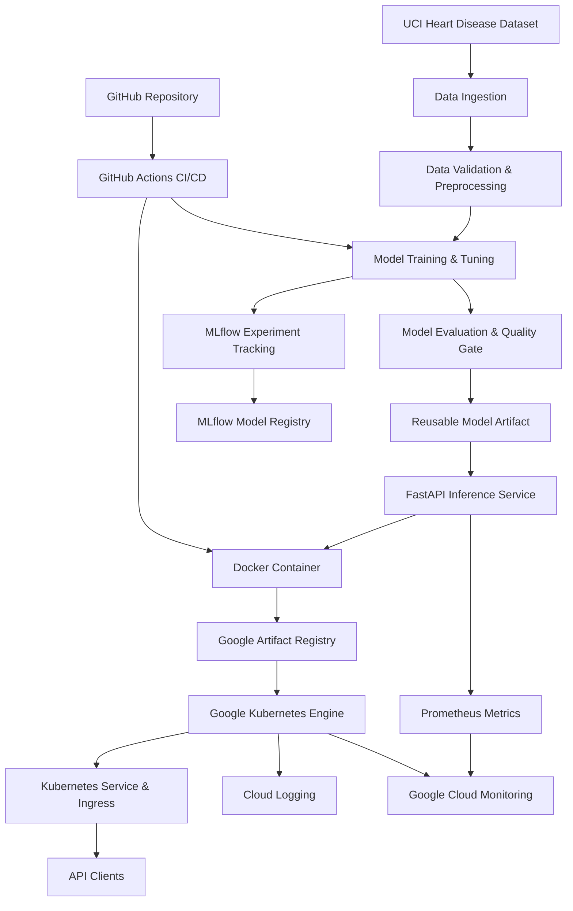
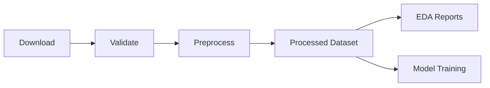
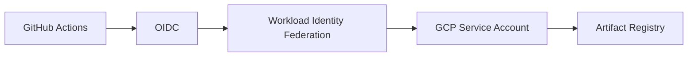
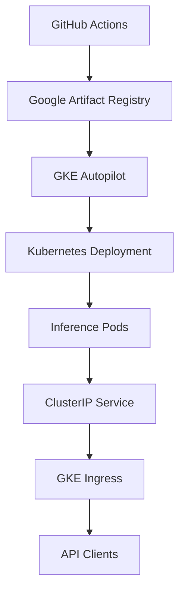

# Heart Disease Prediction — End-to-End MLOps

An end-to-end Machine Learning Operations (MLOps) project demonstrating how a machine learning application can be developed, tested, packaged, deployed, and monitored using modern software engineering and cloud-native practices.

The project integrates data engineering, machine learning pipelines, experiment tracking, REST API development, automated CI/CD, containerization, Kubernetes orchestration, and cloud observability.

**Repository:** [heart-disease-mlops](https://github.com/satyadeep0987/heart-disease-mlops)

> **Disclaimer:** This project is intended for educational and engineering demonstrations. It is not designed or validated for clinical diagnosis or medical decision-making.

---

## 1. System Architecture

The application follows a modular architecture that separates data processing, model development, model management, inference, deployment, and monitoring.



### Architecture Layers

| Layer | Responsibility | Technologies |
|---|---|---|
| Data Engineering | Dataset ingestion, validation, cleaning, EDA | Python, Pandas, NumPy |
| Machine Learning | Training, evaluation, tuning, model selection | Scikit-learn |
| Model Management | Experiment tracking, registry, serialization | MLflow, Joblib, Pickle |
| Application | REST API, request validation, inference | FastAPI, Pydantic |
| Testing | Unit tests, linting, integration checks | Pytest, Ruff |
| CI/CD | Automated training, testing, image publishing | GitHub Actions |
| Containerization | Portable inference environment | Docker |
| Cloud Deployment | Image storage and container orchestration | Artifact Registry, GKE |
| Monitoring | Logging, metrics, uptime monitoring | Prometheus, Google Cloud Monitoring |

---

## 2. Project Structure

```text
heart-disease-mlops/
├── .github/
│   └── workflows/
│       ├── ci.yml
│       ├── model-training.yml
│       ├── docker-ci.yml
│       └── gcp-auth-test.yml
│
├── api/
│   ├── main.py
│   ├── schemas.py
│   ├── model_loader.py
│   └── observability.py
│
├── src/
│   ├── data/
│   │   ├── download.py
│   │   ├── validation.py
│   │   ├── preprocessing.py
│   │   ├── eda.py
│   │   └── pipeline.py
│   │
│   └── models/
│       ├── train.py
│       ├── evaluate.py
│       ├── tune.py
│       ├── package.py
│       ├── tracking.py
│       └── promote.py
│
├── models/
│   └── production/
│       ├── model.joblib
│       ├── model.pkl
│       └── model_metadata.json
│
├── scripts/
│   ├── check_model_quality.py
│   └── export_pickle.py
│
├── tests/
│
├── k8s/
│   ├── deployment.yaml
│   ├── service.yaml
│   ├── ingress.yaml
│   └── podmonitoring.yaml
│
├── docs/
│   ├── PROJECT_REPORT.md
│   ├── EVIDENCE_INDEX.md
│   └── evidence/
│
├── Dockerfile
├── .dockerignore
├── pyproject.toml
├── requirements-serving.txt
└── README.md
```

Generated artifacts and optional files may vary depending on the executed workflows. For example, the Pickle export exists only after running the export script.

### Directory Responsibilities

**`src/data/`** — Handles dataset acquisition, validation, preprocessing, exploratory analysis, and data pipeline orchestration.

**`src/models/`** — Contains the model training, hyperparameter tuning, evaluation, packaging, and experiment tracking logic.

**`api/`** — Implements model inference endpoints, request validation, model loading, and application observability.

**`models/production/`** — Stores the reusable production model and its metadata after packaging.

**`tests/`** — Contains automated tests validating the data pipeline, model components, and API.

**`.github/workflows/`** — Defines automated code validation, model training, Docker verification, and cloud image publishing.

**`k8s/`** — Stores the Kubernetes manifests required to run and monitor the application on GKE.

**`docs/`** — Contains the technical report and supporting project evidence.

---

## 3. Prerequisites

For local development:

- Python 3.12
- Git
- Docker
- A Python-compatible development environment

For cloud deployment:

- Google Cloud project with billing configured
- Google Cloud CLI (`gcloud`)
- Kubernetes CLI (`kubectl`)
- GKE authentication plugin
- Google Artifact Registry repository
- GKE cluster
- GitHub Actions authentication through Workload Identity Federation

## 4. Local Development Setup

### Clone the repository

```bash
git clone https://github.com/satyadeep0987/heart-disease-mlops.git
cd heart-disease-mlops
```

### Create a virtual environment

```bash
python3.12 -m venv .venv
source .venv/bin/activate
```

For Windows:

```powershell
py -3.12 -m venv .venv
.venv\Scripts\Activate.ps1
```

### Install dependencies

The project uses `pyproject.toml` for centralized dependency management.

Install the complete training and development environment:

```bash
python -m pip install --upgrade pip
python -m pip install -e ".[training,dev]"
```

For notebook development:

```bash
python -m pip install -e ".[training,dev,notebook]"
```

For application-only development:

```bash
python -m pip install -e .
```

Docker uses `requirements-serving.txt` to provide a compatible inference environment for the packaged model.

---

## 5. Data Processing Pipeline

The data pipeline is responsible for downloading the source dataset, validating it, transforming it into a model-ready representation, and generating exploratory analysis artifacts.

### Run the pipeline

```bash
python -m src.data.pipeline
```

### Data pipeline execution flow



### Modules

| Module | Purpose |
|---|---|
| `download.py` | Retrieves the source dataset |
| `validation.py` | Checks schema and data quality |
| `preprocessing.py` | Prepares validated training data |
| `eda.py` | Generates exploratory visualizations |
| `pipeline.py` | Orchestrates the complete data workflow |

The pipeline can be executed independently of cloud deployment.

---

## 6. Model Training and Management

The model development layer trains and evaluates classification pipelines using Scikit-learn.

Model selection is based on evaluation criteria implemented by the training workflow.

### Train baseline models

```bash
python -m src.models.train
```

### Run hyperparameter tuning

```bash
python -m src.models.tune
```

### Run the quality gate

```bash
python -m scripts.check_model_quality
```

The quality gate verifies that the selected candidate satisfies the configured acceptance criteria before packaging.

### Package the selected model

```bash
python -m src.models.package
```

The packaged model can then be loaded without repeating the training process.

### Reusable model artifacts

| Artifact | Purpose |
|---|---|
| `model.joblib` | Serialized Scikit-learn preprocessing and classification pipeline |
| `model.pkl` | Optional Pickle export for Python-based reuse |
| `model_metadata.json` | Model identity, artifact integrity, environment, and reproducibility metadata |

The existing inference service loads the Joblib artifact by default.

To generate the optional Pickle export:

```bash
python scripts/export_pickle.py
```

Only load model artifacts from trusted sources. Pickle and Joblib deserialization can execute arbitrary code.

---

## 7. MLflow Experiment Tracking

MLflow provides experiment tracking and model registry capabilities.

The training system can record configurations, evaluation metrics, run information, and model artifacts.

### Start the local MLflow server

```bash
mlflow server \
  --backend-store-uri sqlite:///mlflow.db \
  --default-artifact-root ./mlartifacts \
  --host 127.0.0.1 \
  --port 5000
```

Open:

http://127.0.0.1:5000

### MLflow responsibilities

- Track model experiments and parameters.
- Compare training runs.
- Store model artifacts and metadata.
- Register versioned models.
- Support model aliases for identifying candidate versions.

The project supports model access through both locally packaged artifacts and the MLflow registry, depending on the configured serving mode.

For the deployed Docker service, the default configuration uses the packaged local artifact so inference does not depend on a continuously running MLflow tracking server.

---

## 8. FastAPI Inference Service

The application exposes a REST API for consuming the packaged machine learning model.

### Start the API locally

Ensure the model has been packaged, then run:

```bash
MODEL_SOURCE=local uvicorn api.main:app \
  --host 127.0.0.1 \
  --port 8000
```

### API endpoints

| Endpoint | Method | Purpose |
|---|---|---|
| `/health` | GET | Service liveness |
| `/ready` | GET | Model readiness |
| `/predict` | POST | Model inference |
| `/metrics` | GET | Prometheus-compatible application metrics |
| `/docs` | GET | Interactive API documentation |
| `/openapi.json` | GET | OpenAPI specification |

### Test the API

Health check:

```bash
curl http://127.0.0.1:8000/health
```

Readiness check:

```bash
curl http://127.0.0.1:8000/ready
```

Prometheus metrics:

```bash
curl http://127.0.0.1:8000/metrics
```

### Prediction requests

Open the interactive API documentation:

http://127.0.0.1:8000/docs

Select `POST /predict`, click **Try it out**, and submit a request using the documented input schema.

The API validates the request before passing the input data to the loaded Scikit-learn pipeline.

The model response is returned as structured JSON.

Use synthetic data for demonstrations. This API is not intended for clinical use.

---

## 9. Testing and Code Quality

The project includes automated testing and linting to help detect regressions.

### Run tests

```bash
python -m pytest -q
```

### Run Ruff linting

```bash
python -m ruff check .
```

### Verify Python modules

```bash
python -m compileall -q api src scripts
```

The testing workflow covers the relevant data processing, model and API components.

---

## 10. Docker Containerization

Docker packages the inference application, its dependencies, and the selected model into a portable container image.

### Build the image

Ensure `models/production/model.joblib` and `model_metadata.json` have been generated.

```bash
docker build -t heart-disease-api:local .
```

### Run the container

```bash
docker run --rm \
  --name heart-disease-api \
  -p 8000:8000 \
  -e MODEL_SOURCE=local \
  heart-disease-api:local
```

### Verify the container

```bash
curl http://127.0.0.1:8000/health
```

The container serves the model through the same FastAPI endpoints available during local development.

---

## 11. GitHub Actions CI/CD

GitHub Actions automates validation and delivery activities across the project lifecycle.

### Continuous Integration

**Workflow:** `.github/workflows/ci.yml`

Responsibilities:

- Install development dependencies.
- Run lint checks.
- Execute automated tests.
- Check application source code.

### Model Training

**Workflow:** `.github/workflows/model-training.yml`

Responsibilities:

- Execute the data pipeline.
- Train candidate models.
- Perform hyperparameter tuning.
- Apply the model quality gate.
- Package the selected model.
- Upload training and evaluation artifacts.

The training workflow can be triggered manually through GitHub Actions or by configured repository changes.

### Docker CI/CD

**Workflow:** `.github/workflows/docker-ci.yml`

Responsibilities:

- Prepare the model artifact.
- Build the inference container.
- Start the container.
- Execute API smoke tests.
- Authenticate to Google Cloud.
- Publish a verified image to Artifact Registry.

### Google Cloud Authentication

GitHub Actions uses **Workload Identity Federation** with OpenID Connect (OIDC).

This avoids storing long-lived Google Cloud service-account private keys in the repository.



Only authorized workflows matching the configured identity conditions can obtain cloud credentials.

---

## 12. Google Cloud Deployment

The inference application is deployed using Google Kubernetes Engine Autopilot.

### Deployment architecture



### Cloud resources

| Resource | Configuration |
|---|---|
| GCP project | `heart-disease-mlops-511812` |
| Region | `asia-south1` |
| Artifact Registry | `heart-disease-images` |
| Container image | `heart-disease-api` |
| GKE cluster | `heart-disease-gke` |
| Kubernetes namespace | `mlops` |
| Kubernetes Deployment | `heart-disease-api` |
| Kubernetes Service | `heart-disease-service` |
| Kubernetes Ingress | `heart-disease-ingress` |

### Connect to the GKE cluster

```bash
gcloud config set project heart-disease-mlops-511812

gcloud container clusters get-credentials heart-disease-gke \
  --project=heart-disease-mlops-511812 \
  --location=asia-south1
```

### Deploy the application

Ensure `k8s/deployment.yaml` references an image digest that exists in Artifact Registry.

```bash
kubectl apply -f k8s/deployment.yaml
kubectl apply -f k8s/service.yaml
```

Verify:

```bash
kubectl get deployments,pods,services -n mlops
```

### Test through port-forward

```bash
kubectl port-forward \
  -n mlops \
  service/heart-disease-service \
  8000:80
```

Open:

http://127.0.0.1:8000/docs

### Configure external access

For a temporary public demonstration:

```bash
kubectl apply -f k8s/ingress.yaml
```

Retrieve the Ingress address:

```bash
kubectl get ingress -n mlops
```

The demonstration Ingress uses HTTP. Do not expose sensitive patient information or use an unauthenticated public endpoint for real-world workloads. Production access requires HTTPS and appropriate authentication.

---

## 13. Monitoring and Observability

The application supports operational monitoring across the API and Kubernetes infrastructure.

### Application Metrics

FastAPI exposes Prometheus-compatible metrics through:

```text
GET /metrics
```

Metrics include request counts and response-time distributions.

### Managed Prometheus

GKE Managed Service for Prometheus discovers the inference workload through:

`k8s/podmonitoring.yaml`

Apply the monitoring resource:

```bash
kubectl apply -f k8s/podmonitoring.yaml
```

### Google Cloud Monitoring

Cloud Monitoring provides visibility into:

- API traffic.
- Request latency.
- HTTP error responses.
- Container CPU usage.
- Container memory usage.
- Application availability.

### Cloud Logging

Application and container logs are available through Google Cloud Logging.

Logs can be filtered by the Kubernetes namespace and container name.

### Uptime Monitoring

A Cloud Monitoring uptime check can periodically request `/health` and notify operators if the public endpoint becomes unavailable.

Uptime checks validate endpoint reachability, while prediction smoke tests verify the inference behavior.

---

## 14. Documentation and Evidence

Detailed implementation evidence is maintained separately from this README.

| Document | Purpose |
|---|---|
| `docs/PROJECT_REPORT.md` | Technical methodology, architecture, evaluation and conclusions |
| `docs/EVIDENCE_INDEX.md` | Index of supporting screenshots |
| `docs/evidence/` | Screenshots from model development, CI/CD, deployment and monitoring |

This separation keeps the README focused on architecture and usage while preserving technical results in the project report.

---

## 15. Resource Cleanup

GKE clusters, load balancers and other cloud resources can incur charges.

Remove the public Ingress when it is no longer needed:

```bash
kubectl delete -f k8s/ingress.yaml
```

After completing the demonstration and collecting the required evidence, delete the GKE cluster if you no longer need it:

```bash
gcloud container clusters delete heart-disease-gke \
  --project=heart-disease-mlops-511812 \
  --location=asia-south1
```

Also review Artifact Registry storage, uptime checks, alert policies and other remaining resources.

Deletion of the cluster does not automatically guarantee that every separately billable resource has been removed.

---

## 16. Security and Operational Considerations

The project demonstrates MLOps practices but is not a production clinical system.

Important considerations include:

- Use trusted, validated model artifacts.
- Avoid logging raw patient features or sensitive information.
- Protect publicly accessible inference endpoints.
- Use HTTPS and authentication for production deployments.
- Maintain reproducible model environments.
- Reference immutable container image digests.
- Review model performance and data drift before real-world use.
- Apply least-privilege access to CI/CD and cloud resources.

---

## 17. References

- [UCI Machine Learning Repository](https://archive.ics.uci.edu/)
- [Scikit-learn](https://scikit-learn.org/stable/)
- [MLflow](https://mlflow.org/docs/latest/)
- [FastAPI](https://fastapi.tiangolo.com/)
- [Docker Documentation](https://docs.docker.com/)
- [GitHub Actions Documentation](https://docs.github.com/en/actions)
- [Google Artifact Registry](https://cloud.google.com/artifact-registry/docs)
- [Google Kubernetes Engine](https://cloud.google.com/kubernetes-engine/docs)
- [Google Cloud Monitoring](https://cloud.google.com/monitoring/docs)

---

## Project Summary

This repository demonstrates how to build and operate a machine learning application using an integrated MLOps architecture.

It connects reproducible data pipelines, model training, experiment tracking, reusable artifacts, API serving, automated CI/CD, cloud container deployment, and operational monitoring in a single engineering workflow.

Detailed model evaluation results and execution evidence are maintained in the technical project report rather than this README.