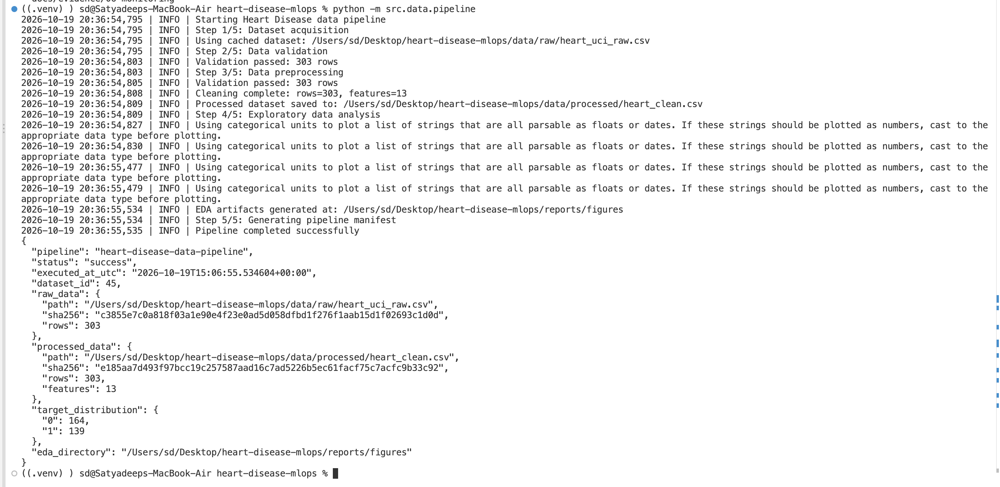
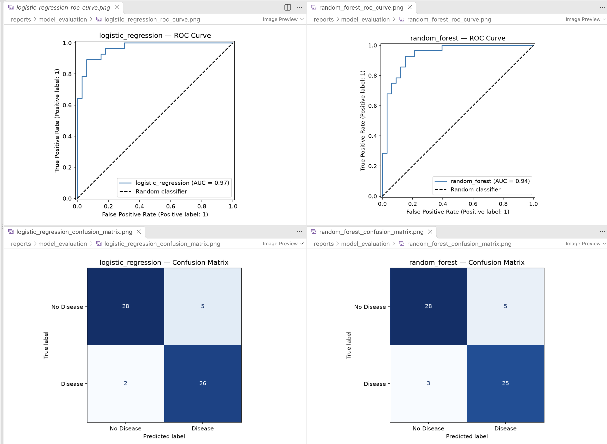
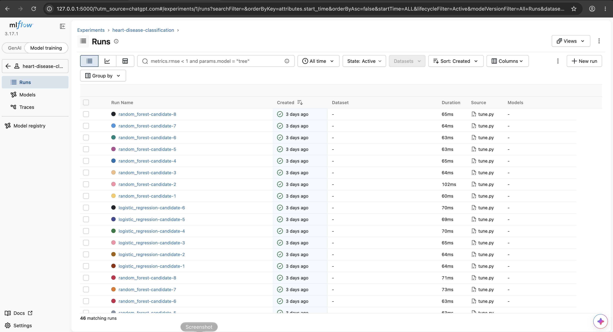
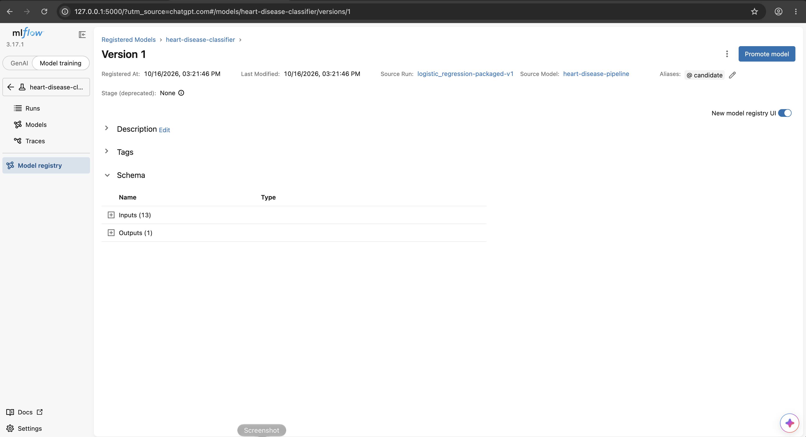

# Heart Disease Prediction Using an End-to-End MLOps Pipeline

**Final Technical Project Report**

**Project Repository:** https://github.com/satyadeep0987/heart-disease-mlops

**Cloud Platform:** Google Cloud Platform (GCP)

**Deployment:** Google Kubernetes Engine (GKE Autopilot)

**Model Version:** 1.0.0

**Report Date:** 16 October 2026

---

## 1. Abstract

This project implements an end-to-end Machine Learning Operations (MLOps) pipeline for binary heart disease classification using the UCI Heart Disease dataset.

The solution integrates automated data ingestion, schema validation, exploratory data analysis, preprocessing, model training, hyperparameter optimization, experiment tracking, model packaging, API development, continuous integration and delivery, Kubernetes deployment, and application monitoring.

Two classification algorithms, Logistic Regression and Random Forest, were evaluated using five-fold cross-validation. Logistic Regression achieved the highest cross-validation ROC-AUC of **0.9028** and was selected as the production model.

The final packaged model was deployed through a FastAPI inference service in Docker on Google Kubernetes Engine, with request-level observability, Google Cloud Monitoring, and uptime monitoring.

The project demonstrates a practical, reproducible MLOps workflow suitable for educational and engineering evaluation. The predictive model is not clinically validated.

## 2. Problem Statement and Objectives

Heart disease classification is a supervised machine learning problem in which patient-related clinical attributes are used to estimate whether recorded heart disease is present.

The objective of this project is to demonstrate how a machine learning model can be developed, validated, packaged, deployed and monitored through a repeatable automated process.

The main objectives are:

- Establish a reproducible data processing pipeline.
- Develop and compare at least two classification algorithms.
- Track experiments and register model artifacts using MLflow.
- Select a model based on cross-validation performance.
- Provide a REST API for real-time inference.
- Automate code validation, training and Docker verification through GitHub Actions.
- Publish container images securely to Google Artifact Registry.
- Deploy the inference application using Kubernetes on GKE.
- Monitor application requests, response latency, resource usage and availability.

## 3. Dataset Description

**Dataset:** UCI Heart Disease

**UCI Repository Dataset ID:** 45

**Total samples used:** 303

**Training samples:** 242

**Holdout samples:** 61

**Input features:** 13

**Target:** `target`

The input variables are:

`age`, `trestbps`, `chol`, `thalach`, `oldpeak`, `sex`, `cp`, `fbs`, `restecg`, `exang`, `slope`, `ca`, and `thal`.

The original target variable `num` is converted to binary form:

- `target = 0`: No recorded heart disease.
- `target = 1`: Heart disease present, where `num > 0`.

The pipeline incorporates data validation and preprocessing prior to model development.

The processed dataset is identified by this SHA-256 checksum:

`e185aa7d493f97bcc19c257587aad16c7ad5226b5ec61facf75c7acfc9b33c92`

This checksum enables dataset provenance verification when reproducing the reported model training.

## 4. Methodology

### 4.1 Data Ingestion and Validation

The project retrieves the Heart Disease dataset from the UCI Machine Learning Repository, validates the incoming schema and value ranges, and prepares cleaned data for model development.

### 4.2 Data Preprocessing

Numerical and categorical attributes are handled through preprocessing transformations contained within Scikit-learn pipelines.

The resulting preprocessing and classifier are packaged together to support consistent inference behavior.

### Dataset Validation Evidence

The UCI Heart Disease dataset was processed using the
automated data pipeline.

### Exploratory Data Analysis Evidence

Exploratory analysis was performed to examine class
distribution, feature distributions and relationships.

### 4.3 Data Splitting

The dataset was divided using an 80/20 stratified train-holdout approach, with `random_state = 42`.

The training portion contained 242 records and the holdout portion contained 61 records.

### 4.4 Model Development

The following algorithms were compared:

**Logistic Regression:** A linear classification model using a regularization parameter and class weighting.

**Random Forest:** An ensemble learning algorithm combining multiple decision trees.

Hyperparameter optimization was performed using GridSearchCV with five-fold cross-validation.

A total of 14 parameter configurations were evaluated: 6 for Logistic Regression and 8 for Random Forest.

## 5. Model Experimentation Results

### 5.1 Five-Fold Cross-Validation

| Metric | Logistic Regression | Random Forest |
|---|---:|---:|
| ROC-AUC | 0.9028 | 0.9020 |
| Accuracy | 0.8304 | 0.8056 |
| Precision | 0.8232 | 0.8109 |
| Recall | 0.8099 | 0.7644 |
| Parameter candidates | 6 | 8 |
| CV folds | 5 | 5 |

**Selection metric:** Cross-validation ROC-AUC.

**Selected model:** Logistic Regression.

The difference in cross-validation ROC-AUC was small, but Logistic Regression also produced higher accuracy, precision and recall for the reported evaluations.

### 5.2 Selected Logistic Regression Parameters

    classifier__C = 0.1
    classifier__class_weight = balanced

The regularization setting controls model complexity, while balanced class weighting adjusts for the class distribution during training.

### 5.3 Best Random Forest Parameters

    classifier__max_depth = 5
    classifier__min_samples_leaf = 3
    classifier__n_estimators = 100

### 5.4 Holdout Evaluation

The packaged Logistic Regression model recorded the following exploratory holdout results:

| Metric | Result |
|---|---:|
| Accuracy | 88.52% |
| Precision | 83.87% |
| Recall | 92.86% |
| ROC-AUC | 96.54% |

**Important evaluation limitation:** The model metadata explicitly labels these results `holdout_metrics_exploratory`. Therefore, they are reported as exploratory performance rather than an independently untouched final test-set estimate.

The model selection report confirms `holdout_used_for_selection = false`, meaning the automated model-selection criterion was cross-validation ROC-AUC rather than the holdout ROC-AUC.

## 6. Model Selection and Quality Gate

The automated model-quality gate requires cross-validation ROC-AUC of at least **0.80**.

The selected Logistic Regression model achieved:

**CV ROC-AUC = 0.9027904463**

This exceeds the configured threshold.

The packaged production model is identified by:

- Model name: `logistic_regression`
- Model version: `1.0.0`
- Selection metric: `cv_roc_auc`
- Random state: `42`

### Model Artifact Integrity

The production model is serialized as a Joblib artifact.

Its recorded SHA-256 checksum is:

`7b382b58f1fa405831ddace100f1272eb9fa590ebe74239790ae3dce25c4bb9f`

The inference application validates the packaged artifact's checksum before loading it.

## 7. MLflow Experiment Tracking

MLflow is used to maintain experiment records, parameter configurations, evaluation metrics and registered model artifacts.

The model tuning records include run identifiers for all 14 candidate parameter configurations.

The registered model is named:

`heart-disease-classifier`

The registry supports a `candidate` alias for referencing a selected model version.

Experiment tracking improves transparency by providing a record of model selection and training configurations.

### MLflow Experiment Tracking Evidence

The MLflow tracking server records the candidate models,
hyperparameters, and cross-validation results.

### Model Registry Evidence

The selected model is registered as
`heart-disease-classifier`, with the `candidate` alias
for versioned model access.

## 8. Reproducibility

The production model metadata records the following environment:

| Dependency | Version |
|---|---|
| Python | 3.12.15 |
| Scikit-learn | 1.9.1 |
| NumPy | 2.5.4 |
| Pandas | 2.3.3 |

The packaged artifact is associated with both dataset and model checksums.

Automated validation compares serving dependency versions with the metadata generated during model training.

Together, these mechanisms strengthen reproducibility and reduce incompatibility risks during container deployment.

## 9. REST API and Model Serving

FastAPI provides endpoints for model inference and operational health checks.

| Endpoint | Method | Description |
|---|---|---|
| `/health` | GET | API availability |
| `/ready` | GET | Model-serving readiness |
| `/predict` | POST | Binary heart disease classification |
| `/metrics` | GET | Prometheus-compatible metrics |
| `/docs` | GET | Interactive API documentation |

Prediction requests contain the 13 expected input variables.

The application validates request schemas using Pydantic and loads the model during application startup.

The inference service runs with Uvicorn inside a Docker container.

## 10. Automated CI/CD

GitHub Actions manages automated code validation and model delivery.

The pipeline contains the following stages:

1. Source checkout and Python environment setup.
2. Data acquisition and preprocessing.
3. Model training and hyperparameter optimization.
4. Cross-validation quality gate.
5. Production model packaging.
6. Serving dependency verification.
7. Docker image build for `linux/amd64`.
8. Container startup and API smoke tests.
9. Authentication to Google Cloud through Workload Identity Federation.
10. Publication of the verified image to Google Artifact Registry.

Cloud authentication uses GitHub OIDC instead of long-lived service-account JSON keys.

## 11. Cloud Deployment Architecture

**Google Cloud Project:** `heart-disease-mlops-511812`

**Region:** `asia-south1`

**Artifact Registry:** `heart-disease-images`

**GKE Cluster:** `heart-disease-gke`

**Kubernetes Namespace:** `mlops`

**Application Deployment:** `heart-disease-api`

**Internal Service:** `heart-disease-service`

**Ingress:** `heart-disease-ingress`

The deployment follows this architecture:

    GitHub Repository
           |
           v
    GitHub Actions CI/CD
           |
           v
    Google Artifact Registry
           |
           v
    GKE Autopilot Cluster
           |
           v
    Kubernetes Deployment
           |
           v
    ClusterIP Service
           |
           v
    GKE Ingress / Load Balancer
           |
           v
    REST API Client

The Kubernetes Deployment uses a single initial replica, resource constraints, startup and readiness probes, and liveness checks.

Container image digests allow the deployed workload to reference an immutable image version.

The external Ingress was verified to return HTTP 200 for `/health` during the deployment demonstration.

## 12. Monitoring and Observability

The application exposes Prometheus-compatible request and latency metrics.

Google Cloud Managed Service for Prometheus collects these metrics using